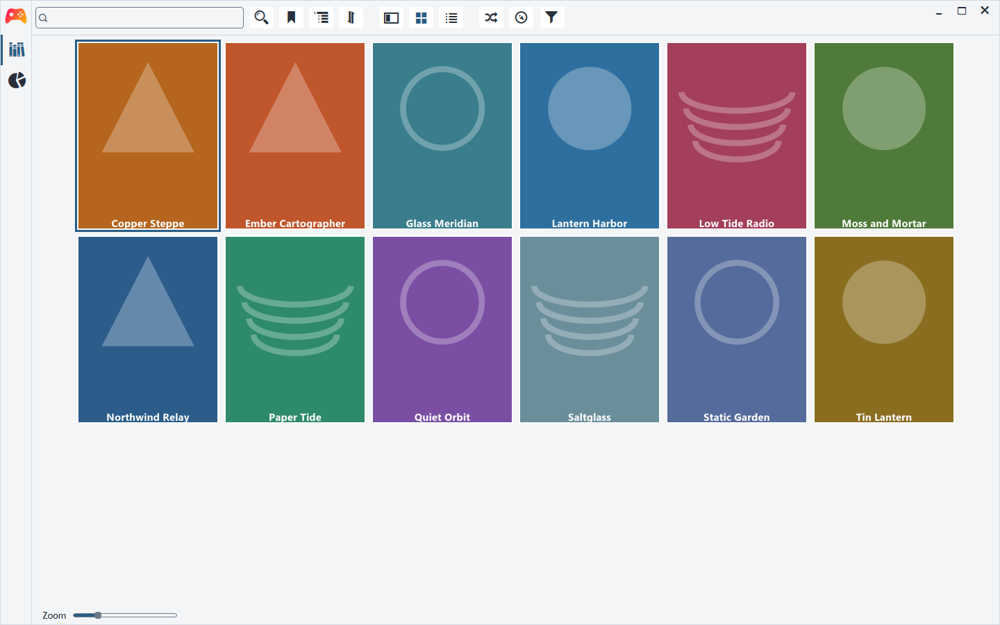

# Flatcap for Playnite

Two Desktop-mode themes for [Playnite](https://playnite.link) 10.x: **Flatcap Slate** (dark) and **Flatcap Daylight** (light). They apply the [Flatcap 2.0](../00-Flatcap) palette, type and metrics to Playnite's own Default theme, changing only what is needed. Each theme ships a dozen small files; Playnite takes everything else from its Default theme.

This project is not affiliated with Playnite or Josef Nemec. It is a derivative of Playnite's Default theme (MIT), see [Third-party code and licenses](#third-party-code-and-licenses).

| Slate, grid view | Slate, details view |
| :--- | :--- |
|  |  |
| **Daylight, grid view** | **Daylight, details view** |
|  |  |

The screenshots show a throwaway library of invented games with generated covers, in a separate portable Playnite copy ([docs/qa-report.md](docs/qa-report.md)).

<!-- build:themes -->
| Theme | Mode | Id | Package | Accent |
| :--- | :--- | :--- | :--- | :--- |
| Flatcap Slate | dark (Playnite Desktop) | `Flatcap_Slate_Desktop` | [`dist/Flatcap_Slate_Desktop_2_0_0.pthm`](https://github.com/cheycron/flatcap-playnite/raw/main/dist/Flatcap_Slate_Desktop_2_0_0.pthm) | `#9BBFDF` |
| Flatcap Daylight | light (Playnite Desktop) | `Flatcap_Daylight_Desktop` | [`dist/Flatcap_Daylight_Desktop_2_0_0.pthm`](https://github.com/cheycron/flatcap-playnite/raw/main/dist/Flatcap_Daylight_Desktop_2_0_0.pthm) | `#285D85` |
<!-- /build:themes -->

## Install

Playnite packages themes as **`.pthm`** files (`.pext` is for extensions; Playnite's installer tells them apart by the extension). This repository therefore ships `.pthm` files in `dist/`.

1. Close Playnite.
2. Pick the theme in `dist/` (`Flatcap_Slate_Desktop_2_0_0.pthm` or `Flatcap_Daylight_Desktop_2_0_0.pthm`).
3. Either open the `.pthm` with Playnite (double click), or unzip it into `<Playnite data folder>/Themes/Desktop/<ThemeId>/` so that `theme.yaml` sits directly in that folder (`<ThemeId>` is `Flatcap_Slate_Desktop` or `Flatcap_Daylight_Desktop`).
4. Start Playnite, open **Settings > Appearance > Theme (Desktop)** and choose Flatcap Slate or Flatcap Daylight. Restart when Playnite asks.

For a copy installed with the installer, the data folder is `%AppData%\Playnite`; for a portable copy it is the folder of `Playnite.DesktopApp.exe`.

The folders `themes/Desktop/<ThemeId>/` in this repository are the same files, unpacked.

## Use it

Nothing to configure. Slate and Daylight are separate themes; switch between them in the same setting. Fullscreen mode is not themed (see Compatibility): it keeps using Playnite's Fullscreen Default.

## Tokens and contrast

Every color, font and size comes from [`src/theme.json`](src/theme.json), a copy of the Flatcap 2.0 core. `scripts/build.py` writes each theme's `Constants.xaml` from it and `--check` fails if a color literal remains in a shipped file, if a contrast target is missed, or if a generated file is stale. The mapping of Playnite's resources to tokens is in [docs/mapping.md](docs/mapping.md). Lowest ratio per group of pairs:

<!-- build:contrast -->
| Pair group | Target | Slate (lowest) | Daylight (lowest) |
| :--- | ---: | ---: | ---: |
| Primary text on every surface | 7 | 7.95 | 10.68 |
| Secondary text on surfaces | 5 | 5.74 | 6.46 |
| Accent (button text, icons, links) on surfaces | 4.5 | 5.75 | 5.68 |
| Text on accent fill and on the badge | 4.5 | 8.36 | 5.98 |
| Control borders and scrollbar thumb | 3 | 4.32 | 4.02 |
| Status colors on canvas and surface | 4.5 | 7.20 | 5.67 |
| Cover name on the overlay (worst case) | 4.5 | 6.38 | 7.54 |
| Cover icons on the overlay (worst case) | 3 | 4.62 | 4.01 |

Every pair is listed in [docs/mapping.md](docs/mapping.md#contrast); 54 targets across both themes, all met.
<!-- /build:contrast -->

## Fonts

The themes ask for IBM Plex Sans, then Segoe UI (the core's stack without generic families, which WPF does not have). **No font is bundled.** If IBM Plex Sans is not installed, WPF falls back to Segoe UI, which Windows has. Install [IBM Plex Sans](https://github.com/IBM/plex) to get the intended look; the screenshots were taken with the machine's own fonts.

## Accessibility

- Contrast targets (WCAG 2.2 ratios): primary text 7:1 on every surface, secondary text 5:1, accent and status colors 4.5:1, control borders 3:1. All are checked by `build.py --check` for both themes.
- Text on the cover overlay (game name, Play and Info icons) is checked against the overlay over a pure white and a pure black cover, the worst cases.
- Playnite's own focus, selection and keyboard behavior are unchanged. Sizes are the core's, with a 13 px minimum.
- **NOT TESTED:** screen readers, Windows High Contrast mode, and keyboard-only operation of every view. The themes only restyle; they do not change controls.

## Compatibility

- Playnite **10.64**, Desktop mode, Windows. The themes declare `ThemeApiVersion: 2.0.0`, the same as Playnite 10.64's Default Desktop theme (the application's Desktop theme API is 2.10.0 and loads 2.x themes).
- Packaging with Playnite's own Toolbox 1.0.0 (`Toolbox.exe pack`) gives a package with the same files and content as `dist/`; see [docs/qa-report.md](docs/qa-report.md). The Toolbox warns that 2.0.0 is not the latest API version; the upstream Default theme has the same value.
- Playnite loads files a theme ships and takes the rest from its Default theme. Because the shipped files are copies of the 10.64 Default files with small patches, **a different Playnite version may need a rebuild**: `--check` fails when a vendored upstream file changes, so the patches never silently drift.
- **Fullscreen mode: not included.** Flatcap Slate for Fullscreen was not attempted in this pass. This is a scope limit of this release, not a decision of the maintainer; see docs/qa-report.md.

**NOT TESTED** (as of this commit):

- Installing the `.pthm` through Playnite's own install flow (double click or add-on installer). Passing the file on the command line at start-up did not install it in the test; the packaged files were extracted by hand into `Themes/Desktop/` instead (the layout the installer produces).
- Any Playnite version other than 10.64.
- Fullscreen mode, other languages, the Playnite add-ons' own windows, high DPI and multiple monitors.
- Views other than the grid and details views of the Desktop main window (list view, the filter panel, menus, dialogs and settings were not reviewed one by one).

## Third-party code and licenses

The shipped XAML files are modified copies of files of the Default theme of [Playnite](https://github.com/JosefNemec/Playnite) 10.64, Copyright (c) 2020 Josef Nemec, MIT License. The unmodified originals are vendored in [`upstream/playnite-10.64/`](upstream/playnite-10.64/) with their SHA-256 sums, and the license text is in [`LICENSES/Playnite-MIT.txt`](LICENSES/Playnite-MIT.txt). Each theme package carries `LICENSE.txt` with both licenses. The Flatcap palette, type and metrics are the Flatcap 2.0 core.

## Contributing

Edit `src/theme.json` (core, do not change here) or `src/playnite.json` (the mapping), then:

```
python3 scripts/build.py --sync     # regenerate themes/, dist/ and the generated blocks of the docs
python3 scripts/build.py --check    # exit 1 on any drift or failed check
python3 scripts/mutation_test.py    # proves each check fails when it should
```

Python 3.10+, standard library only. Do not edit anything under `themes/`, `dist/` or between `<!-- build:... -->` markers by hand.

## License

[MIT](LICENSE) for this repository's own work. Playnite's Default theme files it is derived from are MIT, Copyright (c) 2020 Josef Nemec.
