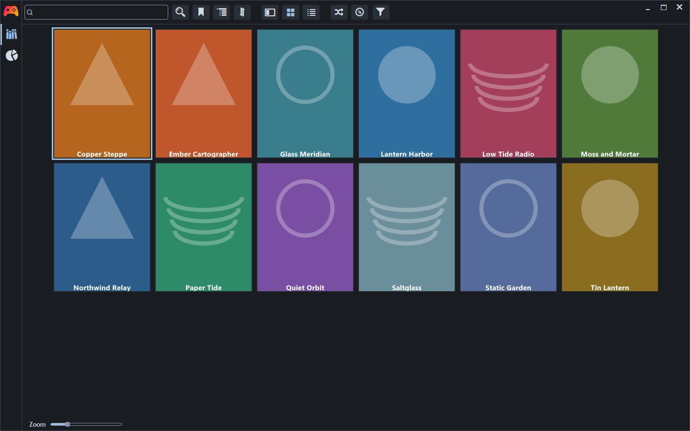
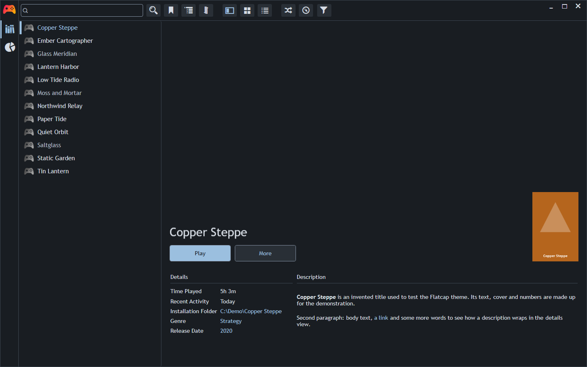
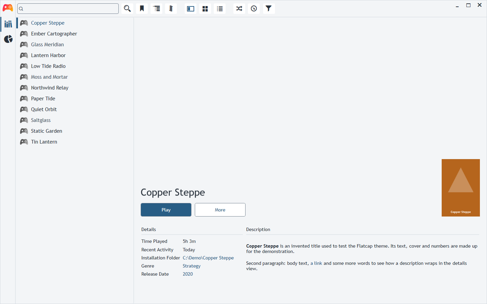
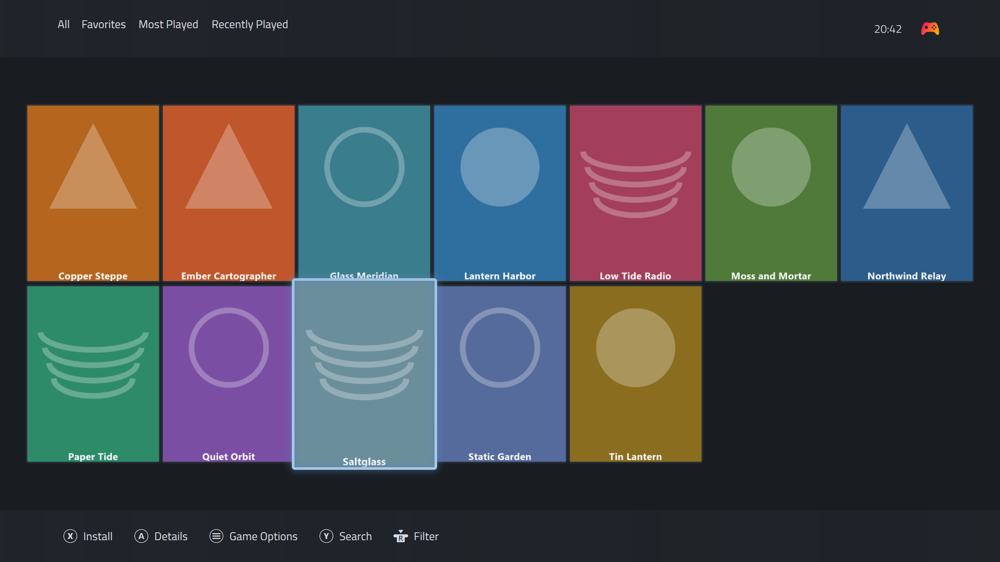
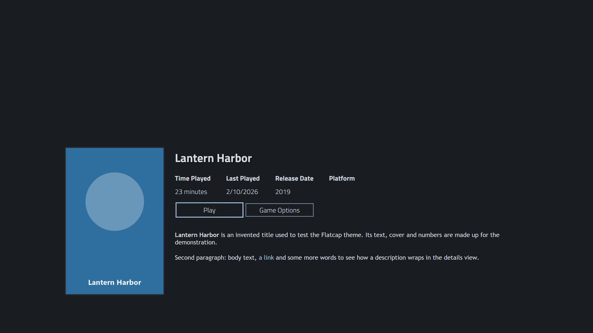
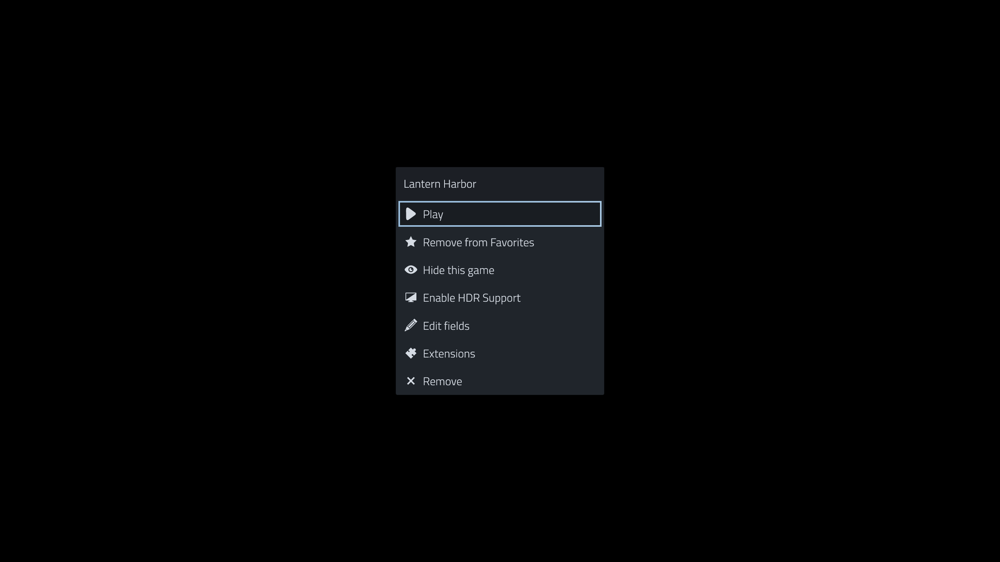

# Flatcap for Playnite

  

Three themes for [Playnite](https://playnite.link) 10.x: **Flatcap Slate** (dark) and **Flatcap Daylight** (light) for Desktop mode, and **Flatcap Slate** for Fullscreen mode. They apply the [Flatcap 2.0](https://github.com/cheycron/flatcap-theme) palette, type and metrics to Playnite's own Default theme, changing only what is needed. Each theme ships sixteen small files (thirteen Default files with small patches, plus a generated `Constants.xaml`, `theme.yaml` and `LICENSE.txt`); Playnite takes everything else from its Default theme.

This project is not affiliated with Playnite or Josef Nemec. It is a derivative of Playnite's Default theme (MIT), see [Third-party code and licenses](#third-party-code-and-licenses).

| Slate, grid view | Slate, details view |
| :--- | :--- |
|  |  |
| **Daylight, grid view** | **Daylight, details view** |
|  |  |

The screenshots show a throwaway library of invented games with generated covers, in a separate portable Playnite copy ([docs/qa-report.md](docs/qa-report.md)).

<!-- build:themes -->
| Theme | Mode | Id | Package | Accent |
| :--- | :--- | :--- | :--- | :--- |
| Flatcap Slate | dark (Playnite Desktop) | `Flatcap_Slate_Desktop` | [`dist/Flatcap_Slate_Desktop_2_0_0.pthm`](https://github.com/cheycron/flatcap-playnite/raw/main/dist/Flatcap_Slate_Desktop_2_0_0.pthm) | `#9BBFDF` |
| Flatcap Daylight | light (Playnite Desktop) | `Flatcap_Daylight_Desktop` | [`dist/Flatcap_Daylight_Desktop_2_0_0.pthm`](https://github.com/cheycron/flatcap-playnite/raw/main/dist/Flatcap_Daylight_Desktop_2_0_0.pthm) | `#285D85` |
| Flatcap Slate | dark (Playnite Fullscreen) | `Flatcap_Slate_Fullscreen` | [`dist/Flatcap_Slate_Fullscreen_2_0_0.pthm`](https://github.com/cheycron/flatcap-playnite/raw/main/dist/Flatcap_Slate_Fullscreen_2_0_0.pthm) | `#9BBFDF` |
<!-- /build:themes -->

## Install

> **Installing replaces the theme's folder.** Both methods end in `Themes/<Mode>/<ThemeId>/` (`<Mode>` is `Desktop` or `Fullscreen`). If that folder exists (an earlier Flatcap, or a copy you edited), treat it as replaced: back up anything of yours and delete it first, so no file of an older version stays behind. Nothing outside that folder is touched.

Playnite packages themes as **`.pthm`** files (`.pext` is for extensions; Playnite's installer tells them apart by the extension). This repository therefore ships `.pthm` files in `dist/`, and the same files are attached to the [GitHub release](https://github.com/cheycron/flatcap-playnite/releases/tag/v2.0.0). The download links in the table above point at `dist/` on `main`.

**From Playnite's add-on browser: not available yet.** The three themes have installer manifests in [`installer/`](installer/), and their [Playnite add-on database](https://github.com/JosefNemec/PlayniteAddonDatabase) entries are ready in [`addon-database/`](addon-database/), but they have **not been submitted**: the database has paused new submissions until its new add-on portal ships. Until they are accepted, the themes do not appear in Playnite's add-on browser and the links below do nothing. Once accepted, each theme can be installed with its add-on URI or found on the web add-on browser:

| Theme | Add-on URI | Web add-on browser |
| :--- | :--- | :--- |
| Flatcap Slate (Desktop) | `playnite://playnite/installaddon/Flatcap_Slate_Desktop` | `https://playnite.link/addons.html#Flatcap_Slate_Desktop` |
| Flatcap Daylight (Desktop) | `playnite://playnite/installaddon/Flatcap_Daylight_Desktop` | `https://playnite.link/addons.html#Flatcap_Daylight_Desktop` |
| Flatcap Slate (Fullscreen) | `playnite://playnite/installaddon/Flatcap_Slate_Fullscreen` | `https://playnite.link/addons.html#Flatcap_Slate_Fullscreen` |

**Manual install (the method that was tested):**

1. Close Playnite.
2. Take the theme from `dist/` (`Flatcap_Slate_Desktop_2_0_0.pthm`, `Flatcap_Daylight_Desktop_2_0_0.pthm` or `Flatcap_Slate_Fullscreen_2_0_0.pthm`). A `.pthm` is a ZIP file.
3. Delete `<Playnite data folder>/Themes/<Mode>/<ThemeId>/` if it exists, then unzip the package into it so that `theme.yaml` sits directly in that folder (`<ThemeId>` is `Flatcap_Slate_Desktop`, `Flatcap_Daylight_Desktop` or `Flatcap_Slate_Fullscreen`; `<Mode>` is the folder of the same name in `themes/` in this repository). The unpacked folders `themes/<Mode>/<ThemeId>/` in this repository are the same files; you can copy one of those instead.
4. Start Playnite and choose the theme (see *Use it* and *Fullscreen* below). Restart when Playnite asks.

For a copy installed with the installer, the data folder is `%AppData%\Playnite`; for a portable copy it is the folder of `Playnite.DesktopApp.exe`.

**Install by opening the `.pthm` with Playnite (double click): not verified.** It should use Playnite's own installer, but it was **not tested**: in the test, passing the file to Playnite's command line at start-up did not install it, and the double-click flow itself was never run. If you try it, check afterwards that `theme.yaml` is directly inside `Themes/Desktop/<ThemeId>/`; if not, use the manual install.

## Use it

Nothing to configure. In Playnite's Desktop mode open **Settings > Appearance > General > Theme** and choose Flatcap Slate or Flatcap Daylight (they are separate themes; you switch between them in that same setting). Restart Playnite when it asks. The Fullscreen theme is a separate one with its own setting (see the Fullscreen section).

**Cover overlay in Daylight.** The overlay Playnite draws over a game cover (the name on hover, and the *Darken uninstalled* effect for games that are not installed) is the theme's own canvas color at 80% opacity. In Slate that is dark, as in Playnite; in **Daylight it is light**, so *Darken uninstalled* lightens the cover of an uninstalled game there instead of darkening it. The text on it keeps its contrast (checked over a pure white and a pure black cover).

## Fullscreen

**Flatcap Slate (Fullscreen)** (`Flatcap_Slate_Fullscreen`) is the dark theme for Playnite's Fullscreen mode, the interface for a TV, a controller or the keyboard from across a room. It is a separate theme from the Desktop ones, with its own folder (`Themes/Fullscreen/Flatcap_Slate_Fullscreen/`) and package (`dist/Flatcap_Slate_Fullscreen_2_0_0.pthm`). It applies the same Slate palette to Playnite 10.64's Default Fullscreen theme.

| Grid | Game details | Menu with the focus on an entry |
| :--- | :--- | :--- |
|  |  |  |

**Install** (manual, the same method as the Desktop themes): close Playnite, delete `<Playnite data folder>/Themes/Fullscreen/Flatcap_Slate_Fullscreen/` if it exists, unzip `dist/Flatcap_Slate_Fullscreen_2_0_0.pthm` into that folder so that `theme.yaml` sits directly in it, and start Playnite.

**Select it.** In Playnite's Desktop mode open **Settings > Appearance > General > Fullscreen Theme** and choose *Flatcap Slate*; or, from inside Fullscreen mode, open the main menu and go to **Settings > Visuals > Theme** (the same setting). It needs a restart of Playnite. The Desktop and the Fullscreen choices do not affect each other.

What is different from the Desktop themes, on purpose:

- **Sizes and font are Playnite's own.** A TV interface needs large text: Fullscreen's smallest text is 18 px (22 px for body text) and uses Titillium Web, which Playnite bundles. `--check` fails if a text size under 18 px appears in a shipped file (as a `FontSize` attribute, a `FontSize` setter, an `HtmlFontSize` or a `FontSize` constant). The one text smaller than that in the Default theme, the game description (16 px), is raised to 20 px. **One exception, on purpose:** the 12 px dot (U+25CF) under the selected preset of the top bar is a decorative shape, not text, and `--check` skips only that element.
- **The focus is the point.** With a controller or the keyboard the only cue of where you are is the focus: it is a 3 to 5 px accent outline (a shape, not a color change alone) on buttons, fields, filter items, settings rows, the top bar and the game covers (with a glow). Every focus outline is checked at 3:1 against every surface it can sit on, and the text of every focused or hovered state at 4.5:1, read from the shipped XAML.
- **No state is shown by color alone.** In the Default theme four states differ from their resting state only by a text color that is 1.2 to 1.4:1 from it (a focused preset in the top bar, a filter with an active selection (two controls) and a checked toggle button). They now also get a signal that is not a color: a 3 px accent underline on the focused preset, bold text and a 2 px underline on an active filter row, bold text on an active filter button, bold text and a 2 px outline on a checked toggle button. `--check` reads each state from the shipped XAML and fails if its color is under 3:1 from the resting one and it has none of those signals.
- **Fixed colors removed.** The Default theme draws black text on a dark fill in a focused combo box (about 1.1:1) and writes white, red and black directly in a few views; those are patched to resources that come from the tokens (list in docs/mapping.md).

<!-- build:fs-contrast -->
| Fullscreen pair group | Target | Slate (lowest) |
| :--- | ---: | ---: |
| Main text: 7 pairs | 4.5 (7 on opaque surfaces) | 5.77 |
| Accent: 7 pairs | 4.5 (3 on the translucent bar) | 4.18 |
| Light accent: 7 pairs | 4.5 (3 on the translucent bars) | 4.81 |
| Control borders: 4 pairs | 3 | 4.32 |
| Status: 5 pairs | 4.5 (3 for the icon) | 3.76 |
| States: 16 pairs | 4.5 (3 for check marks) | 8.80 |
| State vs state: 4 pairs | 3, or a bolder weight / an underline | 1.20 (with a non-color cue) |
| Focus outline: 11 pairs | 3 | 4.18 |

Every pair is listed in [docs/mapping.md](docs/mapping.md#fullscreen-contrast); 61 targets, all met. Translucent surfaces are measured over a pure white and a pure black background picture.
<!-- /build:fs-contrast -->

**Flatcap Daylight for Fullscreen is not made.** It is a technical decision, not an omission: Fullscreen draws game art, covers and a user-chosen background picture behind translucent bars, with text that is meant to be light on a dark layer. A light variant needs its own surfaces for text over art of any brightness (the check would have to prove it over white and black art for dark text too) and a different focus treatment, which is a design of its own and not a recolor of the same files. Slate covers the TV use case; a light Fullscreen theme is left for a later version.

## Tokens and contrast

Every color, font and size comes from [`src/theme.json`](src/theme.json), a copy of the Flatcap 2.0 core. `scripts/build.py` writes each theme's `Constants.xaml` from it and `--check` fails if a color literal remains in a shipped file, if a contrast target is missed, or if a generated file is stale. The mapping of Playnite's resources to tokens is in [docs/mapping.md](docs/mapping.md). Lowest ratio per group of pairs:

<!-- build:contrast -->
| Pair group | Target | Slate (lowest) | Daylight (lowest) |
| :--- | ---: | ---: | ---: |
| Primary text on every surface | 7 | 7.95 | 10.68 |
| Secondary text on surfaces | 5 | 5.51 | 6.28 |
| Accent (button text, icons, links) on surfaces | 4.5 | 5.75 | 5.68 |
| Text on accent fill and on the badge | 4.5 | 8.36 | 5.98 |
| Control borders and scrollbar thumb | 3 | 4.32 | 4.02 |
| Status colors on canvas and surface | 4.5 | 7.20 | 5.67 |
| Cover name on the overlay (worst case) | 4.5 | 6.38 | 7.54 |
| Cover icons on the overlay (worst case) | 3 | 4.62 | 4.01 |

Every pair is listed in [docs/mapping.md](docs/mapping.md#contrast); 64 targets across both themes, all met.
<!-- /build:contrast -->

## Fonts

The themes ask for IBM Plex Sans, then Segoe UI (the core's stack without generic families, which WPF does not have). **No font is bundled.** If IBM Plex Sans is not installed, WPF falls back to Segoe UI, which Windows has. Install [IBM Plex Sans](https://github.com/IBM/plex) to get the intended look; the screenshots were taken with the machine's own fonts.

## Accessibility

- Contrast targets (WCAG 2.2 ratios): primary text 7:1 on every surface, secondary text 5:1, accent and status colors 4.5:1, control borders 3:1. All are checked by `build.py --check` for both themes.
- Text on the cover overlay (game name, Play and Info icons) is checked against the overlay over a pure white and a pure black cover, the worst cases.
- Playnite's own focus and selection logic is not changed: the themes restyle, they do not change which control takes focus or how keys move it. Two states had the normal text color on the accent fill and are patched to the text-on-accent color: the **Play button on hover** and a **list item that has keyboard focus without selection**. Both are checked by `--check` from the shipped XAML (the hover and focus states are read from the files, not assumed). Sizes are the core's, with a 13 px minimum.
- **NOT TESTED:** screen readers, Windows High Contrast mode, and keyboard-only operation of every view.

## Compatibility

- Playnite **10.64**, Desktop mode, Windows. The themes declare `ThemeApiVersion: 2.0.0`, the same as Playnite 10.64's Default Desktop theme (the application's Desktop theme API is 2.10.0 and loads 2.x themes).
- Packaging with Playnite's own Toolbox 1.0.0 (`Toolbox.exe pack`) gives a package with the same files and content as `dist/`; see [docs/qa-report.md](docs/qa-report.md). The Toolbox warns that 2.0.0 is not the latest API version; the upstream Default theme has the same value.
- Playnite loads files a theme ships and takes the rest from its Default theme. Because the shipped files are copies of the 10.64 Default files with small patches, **a different Playnite version may need a rebuild**: `--check` fails when a vendored upstream file changes, so the patches never silently drift.
- **Fullscreen mode:** Flatcap Slate (Fullscreen) declares `ThemeApiVersion: 2.0.0`, the same as Playnite 10.64's Default Fullscreen theme (the application's Fullscreen theme API is 2.10.0 and loads 2.x themes). Same rule as Desktop: the shipped files are copies of the 10.64 Default Fullscreen files, so another Playnite version may need a rebuild.

**NOT TESTED** (as of this commit):

- Installing the `.pthm` through Playnite's own install flow (double click or add-on installer): never run. Passing the file on the command line at start-up did not install it in the test; the packaged files were extracted by hand into `Themes/Desktop/` instead (the layout the installer is expected to produce).
- Any Playnite version other than 10.64.
- Fullscreen: a real game controller, a TV, high DPI, other resolutions than 2560x1440 (the screenshots are that capture scaled to 1920x1080), the main menu and filter screens (captured, not reviewed), and every other Fullscreen view and dialog.
- Other languages, the Playnite add-ons' own windows, high DPI and multiple monitors.
- Views other than the grid and details views of the Desktop main window (list view, the filter panel, menus, dialogs and settings were not reviewed one by one).

## Third-party code and licenses

The shipped XAML files are modified copies of files of the Default theme of [Playnite](https://github.com/JosefNemec/Playnite) 10.64, Copyright (c) 2020 Josef Nemec, MIT License. The unmodified originals are vendored in [`upstream/playnite-10.64/`](upstream/playnite-10.64/) with their SHA-256 sums, and the license text is in [`LICENSES/Playnite-MIT.txt`](LICENSES/Playnite-MIT.txt). Each theme package carries `LICENSE.txt` with both licenses. The Flatcap palette, type and metrics are the Flatcap 2.0 core.

## Contributing

`src/theme.json` is a copy of the [Flatcap core](https://github.com/cheycron/flatcap-theme) and its SHA-256 is pinned in `src/playnite.json` (`core.sha256`): `--check` fails if the copy differs. To take a core change, copy the file over, run `--pin-core`, then `--sync`. Edit `src/playnite.json` for the mapping, then:

```
python3 scripts/build.py --sync     # regenerate themes/, dist/, installer/ and the generated blocks of the docs
python3 scripts/build.py --check    # exit 1 on any drift or failed check
python3 scripts/build.py --pin-core # after copying a new core on purpose
python3 scripts/mutation_test.py    # proves each check fails when it should
```

Python 3.10+, standard library only. Do not edit anything under `themes/`, `dist/`, `installer/` or between `<!-- build:... -->` markers by hand.

**Private names.** `--check` refuses private paths, addresses and names. The generic patterns (private and CGNAT IP ranges, `*.ts.net`, home and `/mnt` paths, Windows user folders, UNC shares, non-noreply emails) are in `scripts/build.py`. Names that only you know (your machines, domains, user name) go in a local `.private-patterns` file, one regular expression per line, which git ignores: copy [`.private-patterns.example`](.private-patterns.example). `FLATCAP_PRIVATE_PATTERNS=<file>` points the check at another file.

## License

[MIT](LICENSE) for this repository's own work. Playnite's Default theme files it is derived from are MIT, Copyright (c) 2020 Josef Nemec.

## Support

If Flatcap makes your workspace calmer, you can support its development.

<p align="center">
  <a href="https://www.buymeacoffee.com/cheycron">
    
  </a>
</p>
